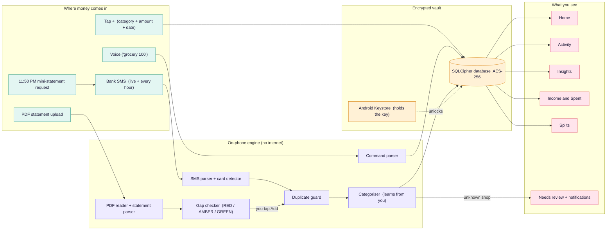
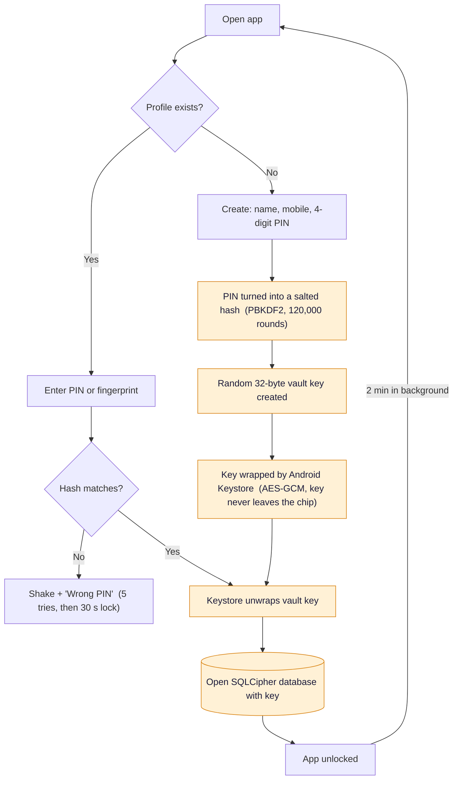
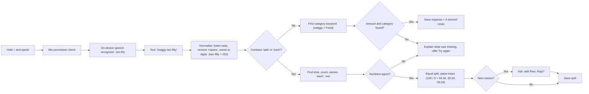
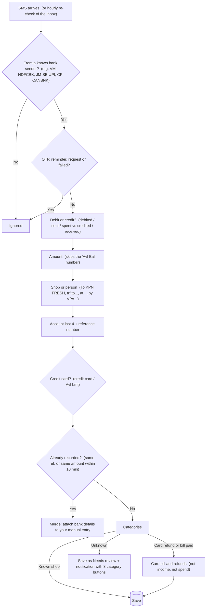
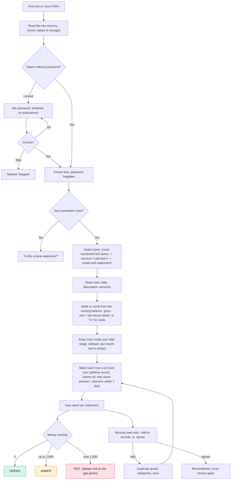
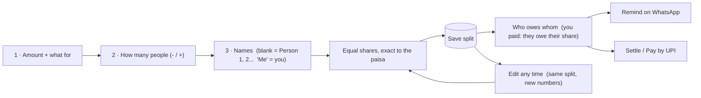
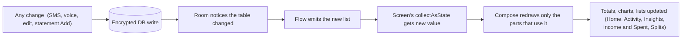
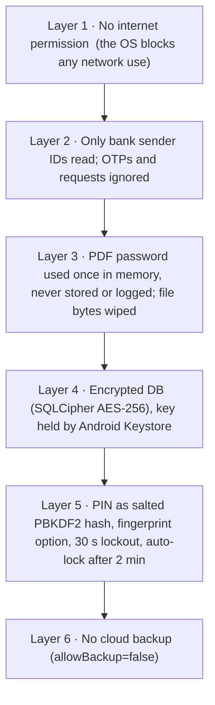

# How SpliWise works, end to end

A private expense tracker and bill splitter. Money comes in from four places (your taps, your voice, bank SMS and PDF statements), gets sorted into categories, and is stored in an encrypted vault that never leaves your phone.

Each component below has two parts:
- 🟢 **Plain words**: what it does, for anyone.
- 🔧 **Under the hood**: how it is built, for engineers (file names included).

| | |
|---|---|
| **0** | internet permissions in the app |
| **AES-256** | encrypted database per profile |
| **4** | ways money gets in |
| **22** | spending categories |
| **40** | automated tests |

**Contents:** [Big picture](#1-big-picture-from-rupee-to-report) · [Login & vault](#2-login-and-the-encrypted-vault) · [Voice](#3-voice-grocery-100-to-a-saved-expense) · [Bank SMS](#4-bank-sms-the-automatic-daily-record) · [PDF statements](#5-pdf-statements-validation-and-the-gap-report) · [Categorising](#6-categorising-who-decides-its-grocery) · [Data storage](#7-data-storage-what-is-kept-and-where) · [Splits](#8-splits-three-steps-and-simple-maths) · [UI rendering](#9-ui-rendering-why-screens-stay-in-sync) · [Background schedule](#10-background-schedule-what-runs-when) · [Latency](#11-latency-how-fast-each-step-is) · [Privacy & security](#12-privacy-and-security-layer-by-layer) · [File map](#13-file-map)

---

## 1. Big picture: from rupee to report

Every path ends in the same place: one encrypted database. The screens only read from it, so a change made anywhere (an SMS, a voice entry, an edit) shows up everywhere at once.

*Solid arrows: data moving. Dotted arrow: the key that unlocks the vault. Nothing in this diagram talks to the internet.*

🟢 **Plain words**
- You add money four ways; the app reads bank SMS by itself.
- Before saving, it checks "did I already record this?" so nothing counts twice.
- It guesses the category (KPN → Grocery). If it can't, it asks you once and remembers.
- Everything is locked in an encrypted vault; every screen reads from that same vault.

🔧 **Under the hood**
- Single source of truth: Room DAOs expose `Flow<List<Txn>>`; Compose screens collect them, so any insert or update re-renders every screen that reads it.
- All writes funnel through `Repo.ingest()` / `Repo.add()` (`data/Repo.kt`).
- Parsers (`SmsParser`, `StatementParser`, `CommandParser`, `Reconciler`) are pure Kotlin with no Android calls, which is why they run in unit tests on a PC.
- The manifest declares no `INTERNET` permission; the OS blocks every socket.

---

## 2. Login and the encrypted vault

Each person on the phone gets a profile (phone number + PIN, optional fingerprint) and their own vault file.

🟢 **Plain words**
- Your PIN is never saved. Only a scrambled fingerprint of it is kept, so even the app can't read it back.
- Your data sits in a locked file. The key to that file lives inside the phone's security chip.
- Someone who copies the file off your phone sees only random bytes.
- Leave the app for 2 minutes and it locks itself again.

🔧 **Under the hood**
- `Crypto.hashPin`: PBKDF2WithHmacSHA256, 16-byte random salt, 120k iterations, 256-bit output; compared with `MessageDigest.isEqual` (constant time).
- `ProfileManager.dbKey`: `SecureRandom` 32 bytes, encrypted with a Keystore AES-256-GCM key (alias `spliwise_master`), stored as base64 in private prefs.
- `SpliDb.open`: Room + `SupportOpenHelperFactory(key)` from SQLCipher 4.6; one DB file per profile, named by SHA-256 of the phone number.
- `allowBackup=false`: no Android cloud backup. The lock timer is in `MainActivity.onStart`.

---

## 3. Voice: "grocery 100" to a saved expense

Speech becomes text on the phone, then a small rulebook turns the text into an expense or a split. No AI model and no internet are involved.

🟢 **Plain words**
- Understands Indian ways of saying numbers: "two fifty" is 250, "1.5k" is 1,500, "15 thousand" is 15,000.
- Understands about 150 everyday words: lunch, petrol, haircut, Swiggy, SIP, plumber…
- If it isn't sure, it tells you exactly what it missed instead of saving something wrong.
- Splits like "split 300 with Mohan Ravi Raju" give ₹100 each.

🔧 **Under the hood**
- `VoiceInput.kt`: `SpeechRecognizer.createOnDeviceSpeechRecognizer` on Android 13+ (audio stays on device); older phones fall back to the system recogniser with `EXTRA_PREFER_OFFLINE`.
- `CommandParser.kt`: pure rules. `wordsToDigits` handles units, tens, hundred/thousand/lakh and the "two fifty" pattern; keywords are matched longest-first with word boundaries.
- Splits use `SplitEngine.equal`: base = total / n, the remainder paise go to the first slots, so the sum is always exact.
- Covered by 13 test groups (about 40 phrasings) in `CommandParserTest`.

---

## 4. Bank SMS: the automatic daily record

Every UPI, card or ATM alert from SBI, HDFC or Canara is read the moment it lands, and the inbox is re-checked every hour in case one was missed.

🟢 **Plain words**
- Only messages from real bank sender IDs are read; personal chats and promotions are skipped.
- OTPs, "will be debited" reminders and money requests are ignored, so they can't create fake spends.
- If you typed "lunch 120" and the bank SMS for ₹120 arrives a minute later, the two become one entry.
- Money credited back to a credit card (bill payment or refund) is kept separately, so it doesn't look like income.

🔧 **Under the hood**
- `SmsReceiver` (manifest receiver, `SMS_RECEIVED`, `goAsync` + IO coroutine); `SmsSyncWorker`: unique periodic WorkManager job, every 1 h, reads `Telephony.Sms.Inbox` since the last scan.
- `SmsParser`: regex stack for amount (verb form first, then Rs/INR excluding balance context), merchant (debit and credit pattern lists with a bad-start filter), account, ref (9 to 16 digits), and `isCreditCard`.
- `Deduper.findMatch`: ref equality, else amount + direction + bank/account + |Δt| ≤ 10 min (same day for date-only rows).
- Unknown merchants: `Notifier.unknown` posts actions handled by `CategorizeReceiver`, which also saves a learned rule.

---

## 5. PDF statements: validation and the gap report

Upload one or many bank or credit-card statements. The app checks each file, asks for a password only if needed, and lists only the transactions SpliWise doesn't have yet.

| Colour | Meaning |
|---|---|
| 🟢 GREEN | nothing missing |
| 🟠 AMBER | up to ₹1,000 missing |
| 🔴 RED | more than ₹1,000 missing |

🟢 **Plain words**
- Each statement card shows three lines: what the PDF has, what SpliWise has (split by SMS / manual / voice), and what's missing.
- The password is used once to open the file and then forgotten. It's never saved.
- Works with any bank layout: it works out debit vs credit from how the balance changes, not from column positions.
- Upload two statements that overlap? Adding a row from one automatically clears it from the other.

🔧 **Under the hood**
- `Importer.pdfText`: PdfBox-Android `PDDocument.load(bytes, pw)`; `InvalidPasswordException` becomes `LockedPdf`; text via `PDFTextStripper(sortByPosition)`.
- `StatementParser`: date-led rows, Indian-grouped money regex, multi-line narrations, value-date skip, newest-first detection, balance-delta direction; card mode = last amount + "Cr" suffix.
- `Reconciler.compare`: one-to-one greedy match (ref, then nearest day ≤ 1), ignored keys from the `ignored` table; `rag()` thresholds 0 / ₹1,000.
- `StatementScreen`: bytes zero-filled and text dropped in `DisposableEffect.onDispose`; the password lives only in dialog state.

---

## 6. Categorising: who decides it's "Grocery"

Four checks run in order and the first one that's sure wins. Your own corrections always beat the built-in list.

1. **Your rules first.** You once tagged "SRI LAKSHMI AGENCIES" as Grocery, so it's always Grocery. *(Rule table, keyed by normalised merchant name; prefix matches too.)*
2. **Built-in shop list (about 300 names).** KPN, DMart, Blinkit → Grocery · HP, IOCL, Shell → Petrol · Zerodha, SIP → Investments · Pepperfry → Home · CRED → Card bill. *(`Categories.merchantDict`: whole-word match for short keys, substring for 5+ letters.)*
3. **Looks like a person?** UPI to a phone number or a personal handle (ravi@okaxis) → Friend transfers. *(`Categorizer.isPersonalVpa / looksLikePerson`, with a business-word filter: store, mart, traders…)*
4. **Still unsure?** Saved as "Needs review". You get a notification with 3 buttons, plus the review screen with notes and ▲ ▼ jump buttons. *(One tap saves a rule and fixes every pending row from that shop.)*

---

## 7. Data storage: what is kept, and where

One encrypted database per profile, with 8 tables. Amounts are stored as whole paise (₹12.50 = 1250), so totals never have rounding errors.

| Table | Holds | Key fields |
|---|---|---|
| **txn** | Every expense, income, card movement | amount (paise), isCredit, category, merchant, note, ts, source (manual/voice/sms/pdf), bank, account, card, refNo, needsReview |
| **category** | 22 categories + your budgets | id, name, emoji, colour, budget |
| **rule** | Shops you taught it | merchantKey → category |
| **person** | Friends for splits | name (unique), phone, upi |
| **split** / **share** | Each split and who owes what | total, payer · per slot: personId (Me / person / unnamed), amount |
| **settlement** | "Ravi paid me back" | personId, amount |
| **ignored** | Statement rows you chose to ignore | key = bank \| account \| date \| amount \| D/C \| ref |

> Outside the vault: the profile list (name, phone, PIN *hash*) and per-bank settings (on/off, request SMS number). No passwords, no statement files, no SMS copies are stored. Database upgrades use migrations (v1 → v2 added the card flag and the ignored table) so updates never wipe your data.

---

## 8. Splits: three steps and simple maths

🟢 **Plain words**
- ₹100 among 3 becomes ₹33.34 + ₹33.33 + ₹33.33. It always adds up exactly.
- Names you type become saved people, so their balance follows them across splits.
- Editing a split changes everyone's balance immediately.

🔧 **Under the hood**
- `Repo.saveSimpleSplit`: resolves labels (Me = 0, "Person N" = null, else find or create a person); edits go through `SplitDao.replace` in one transaction.
- `Ledger.balances`: + share when you paid, − your share when they paid, − settlements. `Ledger.simplify` is a greedy debt minimiser.
- 5,000 random totals tested to sum exactly (`SplitAndMoneyTest`).

---

## 9. UI rendering: why screens stay in sync

Screens are drawn by Jetpack Compose and never keep their own copy of your money data. They subscribe to the vault and redraw themselves when something changes.

🟢 **Plain words**
- Change one number in "Income and Spent" and Home, Insights and budgets update by themselves.
- Charts are drawn by the app itself (no chart add-on), and they animate in when they first appear.
- A bright, colourful light theme throughout.

🔧 **Under the hood**
- Room DAO `Flow` + Compose `collectAsState`; derived numbers come from pure `Stats` functions on each emission (sums over one month are cheap).
- Charts (`Charts.kt`) are hand-drawn on `Canvas`: donut, bars with tap-to-select, calendar heat-map. Animation uses `Animatable` 0→1, and the final frame shows the exact value.
- Lists use `LazyColumn` with stable keys, so only visible rows are composed. Navigation is plain state (no nav library).

---

## 10. Background schedule: what runs when

| When | What happens | Built with |
|---|---|---|
| Instantly | A bank SMS arrives and is parsed, saved, and you're notified if the shop is unknown | `SmsReceiver` (broadcast) |
| Every 1 hour | Re-reads the SMS inbox since the last check, catching anything missed (phone off, app killed) | `SmsSyncWorker` (periodic WorkManager) |
| 11:50 PM | Sends mini-statement SMS requests to the banks you switched on | AlarmManager exact alarm → `RequestWorker` |
| 12:05 AM | Reads the bank replies plus the last 24 h of SMS, then a "today you spent" summary (disappears after 5 s) | `CollectWorker` (delayed one-time work) |
| After reboot | Re-arms the 11:50 PM alarm | `BootReceiver` |
| When you choose | Upload PDF statements and run the gap check | `StatementScreen` (foreground only) |

*Jobs can overlap safely: the duplicate guard makes re-reading the same SMS harmless.*

---

## 11. Latency: how fast each step is

Everything runs on the phone, so there's no network wait anywhere. **These are engineering estimates for a phone like a Galaxy S24 Ultra, not measurements from a device.**

| Step | Typical time (estimate) | Why |
|---|---|---|
| Parse one bank SMS | under 5 ms | A handful of regex passes over ~200 characters |
| Save to encrypted DB | a few ms | Single-row insert; SQLCipher adds a small AES cost per page |
| SMS arrives → visible in app | under 1 s | Broadcast, parse, save, Flow emits, redraw |
| Voice: stop speaking → saved | about 0.5–2 s | Mostly the on-device speech recogniser finalising; the parser itself takes microseconds |
| PIN check | about 0.2–0.6 s | Deliberately slow (120k PBKDF2 rounds) to resist guessing; runs off the main thread |
| Open + read a PDF statement | about 0.5–3 s | Grows with page count; text extraction is the heavy part |
| Gap report for a month | under 50 ms | Hundreds of rows × in-memory matching |
| Screen frame | 8.3 ms budget | 120 Hz display; lists are lazy and charts are single Canvas draws |
| Hourly SMS sync | under 1 s of work | Reads only messages since the last check |

---

## 12. Privacy and security, layer by layer

> **Known limits.** Banks only send the last ~5 transactions by SMS (no custom dates), so live SMS plus statement upload are the real sources. Bank message and PDF formats change over time; the parsers are tested on realistic samples and may need tuning for a new format. Android only: iPhones don't let any app read SMS. Google Play needs an SMS-permission exception before public release.

---

## 13. File map

Native Kotlin 2.0 · Jetpack Compose (Material 3) · Room + SQLCipher · WorkManager · PdfBox-Android · Android SpeechRecognizer · BiometricPrompt

| Package | Files | Responsibility |
|---|---|---|
| `auth/` | ProfileManager, LoginScreen | Profiles, PIN hash, fingerprint, vault key |
| `core/` | Crypto, Money, Dates, Stats | Keystore AES-GCM, PBKDF2, paise maths, Indian number format, analytics |
| `data/` | Entities, Daos, SpliDb, Repo | Tables, queries, encrypted DB + migrations, the single write path |
| `voice/` | VoiceInput, CommandParser | On-device speech, sentence → expense/split |
| `ingest/` | SmsParser, StatementParser, Reconciler, Deduper, Banks, Importer, BankSettings, Background | SMS + PDF reading, gap report, duplicate guard, schedules |
| `classify/` | Categories, Categorizer | 22 categories, ~300 merchants, learning rules |
| `split/` | SplitEngine | Equal/weighted splits, balances, debt simplification |
| `notify/` | Notifier | Category buttons, daily summary (5 s) |
| `ui/` | MainApp, Home, Activity, Insights, Ledger, Splits, Review, Statement, Settings, Charts, Components, Theme | All screens, charts, colourful theme |
| `test/` | CommandParserTest, SplitAndMoneyTest, BankParsingTest, ReconcilerTest | 40 tests run on every build |
